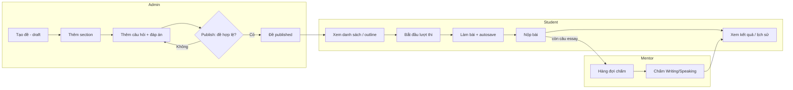
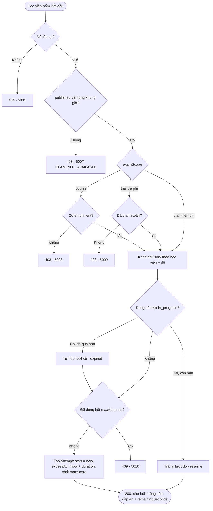
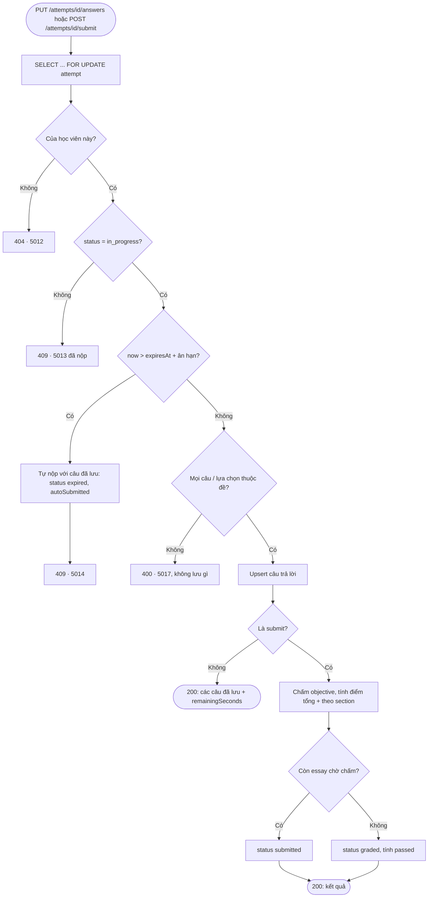
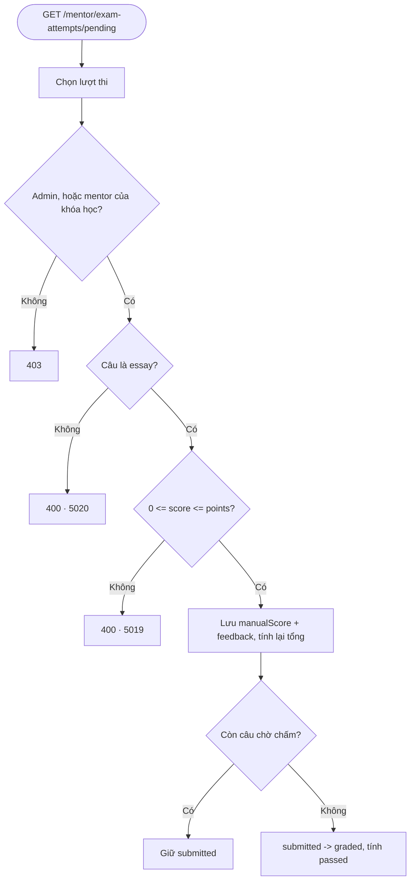
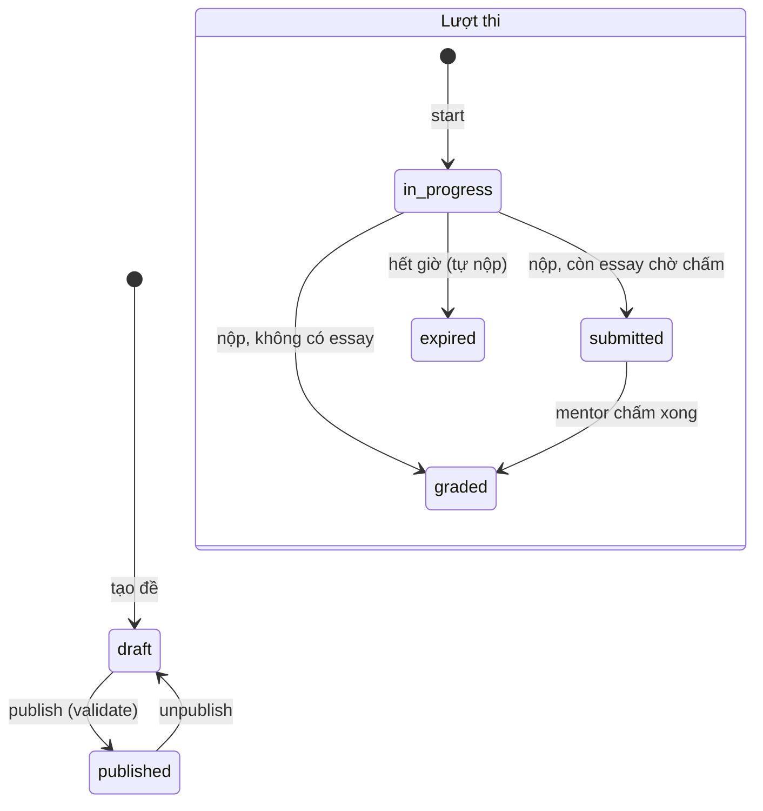

# Dev 3 — Exam / Test Management: Nghiệp vụ, luồng và API

Tài liệu bàn giao cho task D3-01 → D3-18 (trừ D3-17, phần frontend).

## 1. Tổng quan

| Thành phần | File |
|---|---|
| Migration (schema) | `src/main/resources/db/migration/V5__d3_exam_schema.sql` |
| Dữ liệu mẫu (init) | `src/main/resources/db/init/D3_exam_sample_data.sql` |
| Postman | `docs/D3_Exam.postman_collection.json` |
| Entity | `Exam`, `ExamSection`, `Question`, `QuestionOption`, `ExamQuestion`, `ExamAttempt`, `ExamAnswer` |
| Service | `ExamService`, `ExamStructureService`, `ExamAttemptService`, `ExamGradingService`, `ExamGrader`, `ExamAccessPolicy`, `ExamMapper` |
| Controller | `ExamController`, `AdminExamController`, `ExamAttemptController`, `MentorExamGradingController` |
| Test | `ExamGraderTest`, `QuestionValidatorTest`, `ExamAttemptServiceImplTest` |

### Ánh xạ với schema có sẵn

V1 đã có 6 bảng exam, nên module **dùng lại** chúng thay vì tạo bảng mới. V5 chỉ thêm phần còn thiếu.

| Entity (task) | Bảng | Ghi chú |
|---|---|---|
| `Exam` | `exams` | có sẵn từ V1 |
| `ExamSection` | `exam_sections` | **bảng mới (V5)** |
| `Question` | `question_bank` | ngân hàng câu hỏi dùng chung, một câu có thể nằm ở nhiều đề |
| `QuestionOption` | `question_bank_options` | có sẵn |
| `ExamQuestion` | `exam_questions` | gắn câu hỏi vào đề + section + thứ tự; V5 thêm `time_limit_seconds` |
| `ExamAttempt` | `exam_attempts` | V5 thêm `max_score`, `expires_at`, `auto_submitted` |
| `ExamAnswer` | `exam_attempt_details` | V5 thêm `earned_score` |

Cột JSONB `exams.sections` của V1 không còn dùng; section nằm ở bảng `exam_sections`.

## 2. Nghiệp vụ

### 2.1 Đề thi

- **Phạm vi (`examScope`)**
  - `trial`: thi thử theo chứng chỉ, bắt buộc `certificateId`. Miễn phí nếu `isFree = true`; nếu không, học viên phải có giao dịch `trial_exam_access` thành công (bảng của Dev 4).
  - `course`: bài thi của khóa học, bắt buộc `courseId`, học viên phải có enrollment.
- **Loại (`examType`)**: `quiz`, `midterm`, `final`, `placement_test`.
- **Trạng thái**: `draft` → `published` (publish) → `draft` (unpublish). Đề mới luôn là `draft`.
- **Publish** chỉ thành công khi đề có ít nhất 1 câu và mọi câu có bộ đáp án hợp lệ.
- **Chỉ sửa cấu trúc** (section, câu hỏi, đáp án, đổi certificate/course) khi đề là `draft` **và** chưa có lượt thi. Nhờ vậy điểm của các lượt thi cũ không bị sai lệch.
- **Xóa đề** bị từ chối nếu đã có lượt thi (vì FK cascade sẽ xóa lịch sử thi của học viên); khi đó dùng unpublish.
- `passingScore` là **phần trăm** (0–100) trên tổng điểm.
- `maxAttempts`: số lượt tối đa mỗi học viên; `0` nghĩa là không giới hạn.
- `showScore` / `showAnswers`: cho học viên xem điểm / đáp án đúng sau khi nộp.
- `availableFrom` / `availableUntil`: khung thời gian được **bắt đầu** làm bài.

### 2.2 Section

`sectionType` là chuỗi tự do: `LISTENING`, `READING`, `WRITING`, `SPEAKING`, `GENERAL` hoặc giá trị bất kỳ (tự chuyển sang chữ hoa). Section có thể có `passageText` (đoạn đọc), `audioUrl` (file nghe) và liên kết tới `certificate_parts` của Dev 2. Xóa section sẽ gỡ các câu của section đó khỏi đề; câu hỏi vẫn còn trong ngân hàng.

### 2.3 Câu hỏi và đáp án (validation)

| Loại | `options` | Học viên gửi | Chấm |
|---|---|---|---|
| `multiple_choice` | ≥ 2 lựa chọn, **đúng 1** `isCorrect`, không trùng nội dung | `selectedOptionId` | đúng khi chọn lựa chọn đúng |
| `true_false` | **đúng 2** lựa chọn, đúng 1 đáp án đúng | `selectedOptionId` | như trên |
| `fill_blank` | ≥ 1 đáp án được chấp nhận | `answerText` | so khớp sau chuẩn hóa (bỏ hoa/thường, khoảng trắng thừa, dấu chấm câu ở cuối) |
| `matching` | ≥ 2 cặp `"vế trái::vế phải"` | `answerText` = JSON `{"trái":"phải"}` | đúng khi **tất cả** cặp đúng (không cho điểm từng phần) |
| `essay` | không có | `answerText` (bài viết, hoặc URL file ghi âm cho Speaking) | mentor chấm tay |

- Câu đúng được trọn `points`, sai/bỏ trống được 0.
- Thêm câu vào đề theo 2 cách: gửi `questionId` để dùng lại câu trong ngân hàng, hoặc gửi nội dung để tạo câu mới.
- Không sửa được câu đã có học viên trả lời, hoặc câu đang được dùng ở đề khác (hãy tạo câu mới).

### 2.4 Quyền xem đề (D3-07)

| Người xem | `GET /api/v1/exams/{id}` |
|---|---|
| Khách / học viên | đề `published`: chỉ outline (section, số câu, điểm tối đa) + `accessible` + `accessMessage`; đề `draft` → 404 |
| Admin | toàn bộ câu hỏi **kèm đáp án đúng** |

Nội dung câu hỏi (không đáp án) chỉ được trả **bên trong lượt thi** (`POST /exams/{id}/attempts`, `GET /attempts/{id}`), để học viên không xem trước đề khi đồng hồ chưa chạy. Ở góc nhìn học viên: đáp án của `fill_blank` bị ẩn hoàn toàn; `matching` trả `matchingLeft` theo thứ tự và `matchingRight` đã sắp xếp lại theo chữ cái.

### 2.5 Lượt thi

| Trạng thái | Ý nghĩa |
|---|---|
| `in_progress` | đang làm, trước `expiresAt` |
| `submitted` | học viên đã nộp, **còn câu Writing/Speaking chờ mentor chấm** |
| `graded` | đã nộp và chấm xong toàn bộ |
| `expired` | hết giờ, hệ thống tự nộp với các câu đã lưu (`autoSubmitted = true`) |

- `expiresAt = startTime + durationMinutes`. Server có **thời gian ân hạn** `exam.attempt.submit-grace-seconds` (mặc định 30 giây) cho độ trễ mạng.
- Quá hạn + ân hạn: mọi thao tác (lưu đáp án, nộp, xem) sẽ tự nộp lượt thi rồi trả `5014 ATTEMPT_TIME_EXPIRED`; kết quả vẫn xem được. Job `ExamSchedulingConfig` chạy mỗi phút để tự nộp các lượt bị bỏ dở (tắt bằng `exam.sweeper.enabled=false`).
- Gọi `POST /exams/{id}/attempts` khi đang có lượt `in_progress` còn hạn sẽ **trả lại lượt đó** (tiếp tục làm bài sau khi tải lại trang).
- `maxScore` của lượt được chốt khi bắt đầu.

### 2.6 Chống nộp trùng và race condition (D3-16)

| Tình huống | Cơ chế |
|---|---|
| Bấm "Nộp" 2 lần / 2 tab | `SELECT … FOR UPDATE` trên dòng attempt; request sau thấy status ≠ `in_progress` → `409 / 5013` |
| 2 request "Bắt đầu" cùng lúc | `pg_advisory_xact_lock(học viên, đề)` + unique index `uq_exam_attempt_in_progress` |
| Vượt `maxAttempts` khi gọi đồng thời | unique index `(exam_id, student_id, attempt_number)` |
| 1 câu bị lưu 2 dòng | unique index `(attempt_id, question_bank_id)` + upsert dưới row lock |
| Gửi câu hỏi / lựa chọn không thuộc đề | validate toàn bộ request **trước** khi ghi → `400 / 5017`, không có gì được lưu |

### 2.7 Chấm điểm và kết quả (D3-11 → D3-13)

- Khi nộp: tự chấm mọi câu objective, tính `score`, `correctCount`, `incorrectCount`, `unansweredCount` và **điểm theo section**.
- Có câu essay đã làm nhưng chưa chấm → `submitted`, `passed = null`, `pendingManualGrading = true`.
- Mentor/Admin chấm từng câu essay (`0 ≤ score ≤ points`, có nhận xét). Hết câu chờ chấm thì lượt `submitted` chuyển sang `graded`, tính `passed`.
- Admin chấm mọi đề; mentor chỉ chấm đề thuộc khóa học mình phụ trách (`courses.mentor_id`).
- `exams.total_attempts`, `exams.average_score` được cập nhật tự động.
- Kết quả của học viên tôn trọng `showScore` / `showAnswers` của đề.

### 2.8 Tích hợp với dev khác

| Phụ thuộc | Điểm tích hợp | Hiện trạng |
|---|---|---|
| Dev 4 – Enrollment | `SessionEnrollmentChecker.isEnrolled()` → `EnrollmentService` (gọi trong `ExamAccessPolicy`) | đã nối: đề `course` chỉ cho học viên có enrollment `active` |
| Dev 4 – Payment | native query `payment_transactions` (`trial_exam_access`, `success`) | chỉ đọc, không tạo entity trùng với Dev 4 |
| Dev 2 – Certificate / Course | FK `certificate_id`, `course_id`, `certificate_part_id` | dùng repository có sẵn |
| Dev 1 – User / Role | `SecurityUtils`, role `STUDENT` / `USER` được làm bài | — |

## 3. Luồng (flowchart)

### 3.1 Tổng thể



### 3.2 Bắt đầu lượt thi — `POST /api/v1/exams/{id}/attempts`



### 3.3 Lưu đáp án và nộp bài



### 3.4 Chấm Writing / Speaking



### 3.5 Vòng đời trạng thái



## 4. Danh sách API

Tất cả có tiền tố `/api/v1`. Response bọc `ApiResponse` (`code`, `message`, `result`), riêng API danh sách trả `PageResponse` (`currentPage`, `pageSize`, `totalPages`, `totalElements`, `data`) như module Course. Phân trang: `?page=0&size=20&sort=createdAt,desc`.

| # | Method | Endpoint | Quyền | Mô tả |
|---|---|---|---|---|
| 1 | GET | `/api/v1/exams` | Public | Danh sách đề đã publish. Lọc: `keyword`, `examType`, `examScope`, `certificateId`, `courseId`, `level`, `difficulty`, `isFree` |
| 2 | GET | `/api/v1/exams/{id}` | Public / Student | Outline đề + quyền làm bài (`accessible`, `accessMessage`). Admin nhận đủ câu hỏi + đáp án |
| 3 | POST | `/api/v1/exams/{id}/attempts` | Student, User | Bắt đầu (hoặc tiếp tục) lượt thi, trả câu hỏi không kèm đáp án |
| 4 | GET | `/api/v1/attempts/{attemptId}` | Student, User | Trạng thái lượt thi, câu hỏi, câu đã lưu, `remainingSeconds` |
| 5 | PUT | `/api/v1/attempts/{attemptId}/answers` | Student, User | Lưu tạm câu trả lời (autosave) |
| 6 | POST | `/api/v1/attempts/{attemptId}/submit` | Student, User | Nộp bài (body tùy chọn: các câu cuối). Nộp lại → 409 |
| 7 | GET | `/api/v1/me/exam-attempts` | Student, User | Lịch sử thi (lọc `examId`) |
| 8 | GET | `/api/v1/me/exam-attempts/{attemptId}/result` | Student, User | Kết quả: điểm tổng, theo section, đáp án, nhận xét |
| 9 | GET | `/api/v1/admin/exams` | Admin | Danh sách đề mọi trạng thái (thêm lọc `status`) |
| 10 | POST | `/api/v1/admin/exams` | Admin | Tạo đề (draft) – kích hoạt trigger "trial chỉ admin tạo" |
| 11 | GET | `/api/v1/admin/exams/{id}` | Admin | Chi tiết đề kèm đáp án đúng |
| 12 | PUT | `/api/v1/admin/exams/{id}` | Admin | Sửa thông tin đề (trường null = giữ nguyên) |
| 13 | DELETE | `/api/v1/admin/exams/{id}` | Admin | Xóa đề (bị chặn nếu đã có lượt thi) |
| 14 | POST | `/api/v1/admin/exams/{id}/publish` | Admin | Công khai đề (validate đáp án) |
| 15 | POST | `/api/v1/admin/exams/{id}/unpublish` | Admin | Ẩn đề, về draft |
| 16 | POST | `/api/v1/admin/exams/{id}/sections` | Admin | Thêm section |
| 17 | PUT | `/api/v1/admin/exams/{id}/sections/{sectionId}` | Admin | Sửa section |
| 18 | DELETE | `/api/v1/admin/exams/{id}/sections/{sectionId}` | Admin | Xóa section (gỡ câu của section khỏi đề) |
| 19 | POST | `/api/v1/admin/exams/{id}/questions` | Admin | Thêm câu hỏi (mới hoặc từ ngân hàng) + đáp án |
| 20 | PUT | `/api/v1/admin/exams/{id}/questions/{questionId}` | Admin | Sửa câu hỏi / đáp án / vị trí |
| 21 | DELETE | `/api/v1/admin/exams/{id}/questions/{questionId}` | Admin | Gỡ câu hỏi khỏi đề |
| 22 | GET | `/api/v1/admin/questions` | Admin | Tìm trong ngân hàng câu hỏi |
| 23 | GET | `/api/v1/admin/questions/{questionId}` | Admin | Chi tiết câu hỏi ngân hàng |
| 24 | GET | `/api/v1/mentor/exam-attempts/pending` | Admin, Mentor | Hàng đợi bài chờ chấm Writing/Speaking |
| 25 | GET | `/api/v1/mentor/exam-attempts/{attemptId}` | Admin, Mentor | Toàn bộ bài làm để chấm |
| 26 | PUT | `/api/v1/mentor/exam-attempts/{attemptId}/answers/{questionId}/grade` | Admin, Mentor | Chấm một câu essay (`score`, `feedback`) |

So với danh sách API dự kiến của task: thêm tiền tố `/api/v1` cho thống nhất với các module khác; publish/unpublish, section, câu hỏi, ngân hàng câu hỏi và chấm tay là các API bổ sung cho D3-03/04/05/12.

### Ví dụ request

Tạo đề:

```json
POST /api/v1/admin/exams
{
  "examScope": "trial", "certificateId": "…", "examCode": "IELTS-MOCK-01", "examType": "placement_test",
  "examTitle": "IELTS Mock Test 1", "durationMinutes": 60, "passingScore": 50, "maxAttempts": 3,
  "showAnswers": true, "showScore": true, "isFree": true, "recommendedLevel": "B1"
}
```

Thêm câu hỏi:

```json
POST /api/v1/admin/exams/{id}/questions
{ "sectionId": "…", "questionType": "multiple_choice", "questionText": "Where does Tom work?", "points": 1,
  "explanation": "…", "timeLimitSeconds": 60,
  "options": [ {"optionText": "In a bank"}, {"optionText": "In a bakery", "isCorrect": true} ] }

{ "questionType": "fill_blank", "questionText": "Tom ___ to London.", "options": [ {"optionText": "moved"} ] }
{ "questionType": "matching", "questionText": "Nối từ", "points": 2,
  "options": [ {"optionText": "dog::chó"}, {"optionText": "cat::mèo"} ] }
{ "questionType": "essay", "questionText": "Describe your hometown.", "points": 6 }
```

Lưu đáp án:

```json
PUT /api/v1/attempts/{attemptId}/answers
{ "answers": [
  { "questionId": "…", "selectedOptionId": "…", "timeSpentSeconds": 20 },
  { "questionId": "…", "answerText": "moved" },
  { "questionId": "…", "answerText": "{\"dog\":\"chó\",\"cat\":\"mèo\"}" },
  { "questionId": "…", "answerText": "My hometown is …" }
] }
```

Chấm essay:

```json
PUT /api/v1/mentor/exam-attempts/{attemptId}/answers/{questionId}/grade
{ "score": 4.5, "feedback": "Good structure, watch your tenses." }
```

## 5. Mã lỗi

| Code | HTTP | Ý nghĩa |
|---|---|---|
| 5001 | 404 | Không tìm thấy đề (hoặc đề chưa publish với người không phải admin) |
| 5002 | 409 | Trùng mã đề |
| 5003 | 404 | Không tìm thấy section |
| 5004 | 404 | Không tìm thấy câu hỏi |
| 5005 | 409 | Chỉ sửa cấu trúc khi đề là draft |
| 5006 | 409 | Đề đã có lượt thi |
| 5007 | 403 | Đề không khả dụng (chưa publish / ngoài khung giờ) |
| 5008 | 403 | Cần enrollment khóa học |
| 5009 | 403 | Cần thanh toán |
| 5010 | 409 | Hết số lượt thi |
| 5011 | 400 | Đề chưa hợp lệ để publish |
| 5012 | 404 | Không tìm thấy lượt thi (hoặc của người khác) |
| 5013 | 409 | Lượt thi đã nộp |
| 5014 | 409 | Hết giờ, hệ thống đã tự nộp |
| 5015 | 409 | Lượt thi chưa nộp nên chưa có kết quả |
| 5016 | 400 | Đáp án của câu hỏi không hợp lệ |
| 5017 | 400 | Câu trả lời không hợp lệ |
| 5018 | 404 | Không tìm thấy câu trả lời |
| 5019 | 400 | Điểm chấm không hợp lệ |
| 5020 | 400 | Câu tự chấm, không chấm tay |
| 5021 | 409 | Câu hỏi đã được dùng, không sửa được |
| 5022 | 400 | Phạm vi đề không hợp lệ |
| 5023 | 409 | Câu hỏi đã có trong đề |

## 6. Gợi ý tích hợp frontend (D3-17 — thay `MOCK_EXAM` trong `ExamRoomPage`)

1. Vào phòng thi: `POST /exams/{id}/attempts` → render `result.exam.sections[].questions[]` và `unsectionedQuestions[]`, dùng `displayNumber` để đánh số câu.
2. Đồng hồ: đếm ngược từ `remainingSeconds` (giờ server), không dùng giờ máy client.
3. Autosave: gọi `PUT /attempts/{id}/answers` khi đổi đáp án (debounce 1–2 giây) hoặc mỗi 30 giây.
4. Tải lại trang: `GET /attempts/{id}` (hoặc gọi lại bước 1) → khôi phục từ `answers[]`.
5. Hết giờ: gọi `POST /attempts/{id}/submit`; nếu nhận `5014` thì chuyển thẳng sang trang kết quả.
6. Kết quả: `GET /me/exam-attempts/{id}/result`; khi `pendingManualGrading = true` hiển thị "Đang chờ chấm Writing/Speaking".

Matching: hiển thị `matchingLeft` và dropdown `matchingRight`, gửi `answerText = JSON.stringify({ [trái]: phải })`.

## 7. Chạy và kiểm thử

```bash
# 1. Chạy app (Flyway tự áp dụng V5)
mvn spring-boot:run

# 2. Nạp dữ liệu mẫu
psql -h localhost -U postgres -d englishcenter -f src/main/resources/db/init/D3_exam_sample_data.sql

# 3. Unit test module Exam (không cần DB)
mvn test -Dtest="Exam*Test,QuestionValidatorTest"
```

Cấu hình (`application.properties`):

| Key | Mặc định | Ý nghĩa |
|---|---|---|
| `exam.attempt.submit-grace-seconds` | 30 | thời gian ân hạn khi nộp sau `expiresAt` |
| `exam.sweeper.enabled` | true | bật job tự nộp lượt thi quá hạn |
| `exam.sweeper.fixed-delay-ms` | 60000 | chu kỳ chạy job |

## 8. Lưu ý cho team

- **Migration**: `V5__d3_exam_schema.sql`, nối tiếp `V4` của Dev 4.
- `ExamType` có nhãn DB `final` trùng từ khóa Java nên map qua `ExamTypeConverter` + `cast(? as exam_type_enum)`; các enum còn lại dùng `NAMED_ENUM` như module Course.
- File dùng chung có sửa (chỉ thêm phần của Dev 3): `ErrorCode` (mã 5001-5023), `SecurityConfig` (public `GET /api/v1/exams`, `/api/v1/exams/*`), `application.properties` (`exam.*`).
- Chưa làm: `band_score` / `scaled_score` (quy đổi IELTS/TOEIC), chấm bằng AI, cập nhật `question_bank.correct_rate`, gửi notification khi có kết quả (Dev 5).
